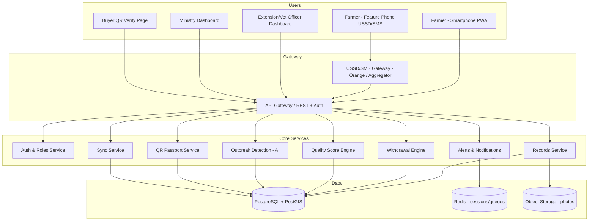
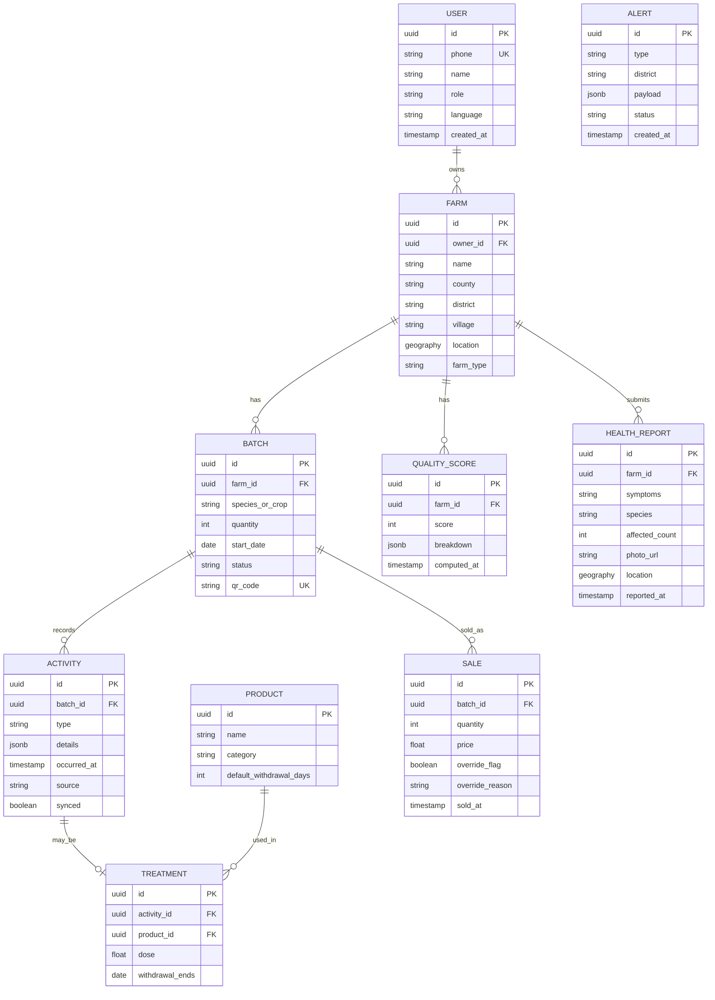

# FarmTrace Liberia
### Digital Farm Records & Quality Management — Works Offline, Works on Any Phone

> **Hackathon:** World Bank × Orange Liberia × Ministry of Health Liberia (3 days)
> **Problem Statement:** Digital farm record and quality management
> **One-liner:** *FarmTrace turns a farmer's phone (smartphone or basic USSD/SMS) into a farm logbook, a quality certificate, and an early-warning system, so farmers earn more, buyers trust what they buy, and the Ministry sees problems before they spread.*

---

## Table of Contents
1. [Executive Summary](#1-executive-summary)
2. [Phase 1: Problem Analysis & Discovery](#2-phase-1-problem-analysis--discovery)
3. [Phase 2: Requirements](#3-phase-2-requirements)
4. [Phase 3: System Design](#4-phase-3-system-design)
5. [Phase 4: Implementation Plan](#5-phase-4-implementation-plan)
6. [Phase 5: Testing & Quality Assurance](#6-phase-5-testing--quality-assurance)
7. [Phase 6: Deployment](#7-phase-6-deployment)
8. [Phase 7: Maintenance, Scale & Sustainability](#8-phase-7-maintenance-scale--sustainability)
9. [3-Day Hackathon Battle Plan](#9-3-day-hackathon-battle-plan)
10. [Winning Strategy: Pitch & Demo](#10-winning-strategy-pitch--demo)
11. [Risks & Mitigations](#11-risks--mitigations)
12. [Project Structure & Setup](#12-project-structure--setup)
13. [Appendix](#13-appendix)

> ⚠️ **Note:** Statistics and organizational details must be verified and cited from official sources (MoH, MoA, FAO, World Bank, LISGIS) before the pitch. Placeholders marked `[VERIFY]` need field validation.

---

## 1. Executive Summary

### 1.1 The Problem
Smallholder farmers in Liberia (crops, poultry, pigs, goats, fish) mostly keep **no written records**, or keep them on paper that gets lost, wet, or destroyed. The consequences:

| Gap | Consequence |
|---|---|
| No record of inputs, treatments, vaccinations | Cannot prove produce/animals are safe; buyers pay low "unknown quality" prices |
| No record of antibiotic/pesticide use and withdrawal periods | Risk of chemical/drug residues entering the food chain (a **public health** issue) |
| No traceability | Disease outbreaks (e.g., avian flu, swine fever, anthrax, aflatoxin) cannot be traced to source |
| No yield/cost history | Farmers cannot access credit, insurance, or support programs |
| No data for government | Ministries plan blind; extension officers visit blindly |

### 1.2 Our Solution
**FarmTrace** is a three-channel platform:

1. **📱 Farmer App (PWA, offline-first):** log activities in seconds with big icons, local-language voice prompts, and photos.
2. **☎️ USSD/SMS channel (any phone, no data needed):** designed for Orange Liberia's network; farmers dial a short code to record and receive alerts.
3. **🖥️ Dashboards:** for Extension/Veterinary Officers, Ministry of Health, and Optional (Buyers (verify farm quality via QR code)).

**Core differentiators:**
- **Quality Score (0–100)** computed from records (hygiene, vaccination, withdrawal compliance, storage) with an explainable AI layer.
- **Withdrawal-Period Guard:** warns "Do NOT sell this chicken until 12 Dec; antibiotic still in the system."
- **One Health early warning:** clustering of symptom reports to flag outbreaks to the Ministry.
- **QR "Farm-to-Fork" passport** for every batch.
- **Inclusive by design:** works offline, on feature phones, in simple English/Liberian English, with voice and icons for low-literacy users.

### 1.3 Alignment With the Three Hosts

| Host | What they care about | How FarmTrace delivers |
|---|---|---|
| **World Bank** | Smallholder productivity, financial inclusion, scalable digital public goods | Records → credit-readiness score; open APIs; cost-effective scale |
| **Orange Liberia** | Network usage, mobile services, mobile money | USSD/SMS channel, Orange Money-ready payments & airtime incentives, B2B2C model |
| **Ministry of Health** | Food safety, zoonotic disease, antimicrobial resistance (AMR) surveillance | Withdrawal-period enforcement, antibiotic-use logs, outbreak alerts, trace-back |

---

## 2. Phase 1: Problem Analysis & Discovery

### 2.1 Stakeholders

| Stakeholder | Role | Primary Need | Influence |
|---|---|---|---|
| Smallholder farmer | Primary user | Simple, fast, free-ish recording; better prices | High |
| Women & youth farmers | Primary user | Low-literacy-friendly UX, credit access | High |
| Extension / Veterinary officer | Power user | See which farms need visits; verify records | High |
| Ministry of Health (food safety, One Health) | Regulator | Residue control, outbreak early warning | High |
| Ministry of Agriculture | Policy | Production data, program targeting | High |
| Buyers (markets, hotels, schools, exporters) | Consumer of data | Trust in quality, traceability | Medium |
| Microfinance / banks / insurers | Data consumer | Verified farm history for lending | Medium |
| Orange Liberia | Channel partner | Traffic, mobile money, new services | High |
| World Bank / donors | Funder | Measurable impact, scalability | High |

### 2.2 User Personas

**Persona 1: Mama Kebeh, 46, poultry & cassava farmer, Bong County**
Feature phone (basic Orange SIM), limited reading skills, sells at the market. *Pain:* buyers pay low because they don't trust her chickens; lost her record of vaccination. *Goal:* prove her birds are safe; earn more.

**Persona 2: Samuel, 27, pig farmer with smartphone, Margibi County**
Has Android, unstable data. *Pain:* lost 20 pigs to disease, never knew the source. *Goal:* track feed, health, costs; qualify for a loan.

**Persona 3: Dr. Wehyee, County Veterinary Officer**
Covers many farms with few resources. *Pain:* no data to prioritise visits. *Goal:* see risky farms on a map and receive outbreak alerts.

**Persona 4: Ma Hawa, hotel buyer in Monrovia**
*Pain:* cannot verify farm-source safety. *Goal:* scan QR, see verified quality.

### 2.3 Problem Tree

```
EFFECTS:   Foodborne illness | Low farmer income | Slow outbreak response | No farm credit
              ▲                      ▲                    ▲                    ▲
CORE PROBLEM:        No reliable digital farm records or quality verification
              ▲                      ▲                    ▲                    ▲
CAUSES:   Paper/no records | Low digital literacy | Poor connectivity | No shared system | No incentives
```

### 2.4 Constraints (Liberia Context)
- **Connectivity:** patchy 3G/4G in rural counties → **offline-first** is mandatory.
- **Devices:** many feature phones → **USSD/SMS** is mandatory.
- **Literacy & language:** English + local languages; use **icons, voice, and simple wording**.
- **Power:** limited electricity → light apps, low battery use.
- **Trust & data privacy:** farmers must control their data.
- **Cost:** USSD sessions and data must be cheap or sponsored (zero-rating a potential Orange partnership).

### 2.5 Competitive / Landscape Scan `[VERIFY]`
Existing agri-apps (e.g., FarmLogs, Digital Green, Esoko, 1000 Farmers type platforms) are mostly crop-focused, smartphone-dependent, or lack **health/food-safety integration**. Gap: **a Ministry-of-Health-aligned, offline + USSD, livestock-and-crop quality system with withdrawal-period enforcement.**

### 2.6 Success Metrics (KPIs)

| KPI | Target (pilot, 6 months) |
|---|---|
| Farmers registered | 1,000 |
| % using USSD/SMS vs app | Track (aim ≥ 50% USSD) |
| Records logged per farm per month | ≥ 8 |
| Withdrawal-period violations prevented | Track & report |
| Average farm quality score improvement | +15 points |
| Outbreak alert time-to-Ministry | < 24 hours |
| Price premium for verified batches | +10–20% |

---

## 3. Phase 2: Requirements

### 3.1 Functional Requirements (MoSCoW)

#### 🔴 MUST HAVE (MVP for hackathon)
| ID | Requirement |
|---|---|
| FR-01 | Farmer registration (phone number, name, county/district/village, farm type) with OTP verification |
| FR-02 | Create and manage farm profiles with GPS (optional) and farm type (poultry, pigs, goats, crops, fish) |
| FR-03 | Log activities: feeding, vaccination, treatment (drug name + dose), planting, spraying, harvest, mortality, sales |
| FR-04 | **Offline-first** capture with automatic background sync |
| FR-05 | **Withdrawal-period engine:** after treatment/spray, compute earliest safe sale/harvest date and block/warn |
| FR-06 | **Farm Quality Score** (0–100) with breakdown and improvement tips |
| FR-07 | **Batch/lot QR passport** showing farm, key records, quality grade |
| FR-08 | **USSD flow** for basic logging (register, log vaccination/treatment, check withdrawal status, report sick animals) |
| FR-09 | SMS alerts/reminders (vaccination due, withdrawal ends, outbreak nearby) |
| FR-10 | **Officer dashboard:** farms list, map, quality scores, overdue actions |
| FR-11 | **Ministry dashboard:** aggregate analytics, antibiotic-use stats, outbreak alerts |
| FR-12 | Disease/symptom report with photo and location |

#### 🟡 SHOULD HAVE
| ID | Requirement |
|---|---|
| FR-13 | Voice prompts / audio guidance (local language) |
| FR-14 | Buyer portal: scan QR → verify |
| FR-15 | Expense/income tracking → profit summary |
| FR-16 | Credit-readiness report (PDF) for lenders |
| FR-17 | AI photo triage for common crop/poultry issues (suggestion only, never diagnosis) |
| FR-18 | Role-based access (farmer, officer, ministry, buyer, admin) |

#### 🟢 COULD HAVE
| ID | Requirement |
|---|---|
| FR-19 | Orange Money integration for payments / premium incentives |
| FR-20 | Cooperative / group-level management |
| FR-21 | Weather advisories |
| FR-22 | Multi-language UI (Kpelle, Bassa, Kru, etc.) |

#### ⚪ WON'T (this phase)
Blockchain ledger, drone imagery, IoT sensors (listed in roadmap).

### 3.2 Non-Functional Requirements

| Category | Requirement |
|---|---|
| **Performance** | Core screens load < 3s on 3G; app bundle < 2 MB initial |
| **Availability** | 99% uptime target on pilot infra; offline continuity 100% for logging |
| **Scalability** | Support 10,000 farmers and 100 concurrent sessions at pilot; horizontally scalable |
| **Usability** | Max 3 taps to log common activity; icon-first UI; WCAG 2.1 AA contrast |
| **Security** | TLS everywhere; encrypted data at rest; RBAC; audit logs |
| **Privacy** | Farmer consent; data minimisation; aligned with Liberian & international data-protection principles; farmer owns data |
| **Interoperability** | REST API + OpenAPI spec; export CSV/JSON; DHIS2-compatible export for health data `[VERIFY]` |
| **Localization** | English first; i18n framework ready for local languages |
| **Reliability** | Conflict-free sync (last-write-wins + event log) |
| **Maintainability** | Modular code, ≥ 60% test coverage on core logic, CI pipeline |

### 3.3 User Stories (Selected)

```gherkin
Feature: Withdrawal-period guard
  As a farmer
  I want to be warned if I try to sell animals still under drug withdrawal
  So that I do not sell unsafe food

  Scenario: Selling too early
    Given I treated batch "Chickens-A" with Oxytetracycline on 1 Dec
    And the withdrawal period is 7 days
    When I try to log a sale on 4 Dec
    Then I see a red warning "Not safe to sell until 8 Dec"
    And the sale is flagged "high-risk" unless I confirm override with reason
```

```gherkin
Feature: USSD logging
  As a farmer with a feature phone
  I want to dial a code and log a vaccination
  So that I do not need a smartphone

  Scenario: Log vaccination via USSD
    Given I dial *XXX# (shortcode TBD with Orange)
    When I select "2. Log Vaccination" and choose my batch
    Then my record is saved and I receive a confirmation SMS
```

```gherkin
Feature: Outbreak early warning
  As a Ministry officer
  I want an alert when several farms in a district report similar symptoms within 72 hours
  So that I can respond quickly

  Scenario: Cluster detected
    Given 3 farms in the same district report "sudden death in poultry" within 72 hours
    Then an alert is created on the Ministry dashboard with a map and affected farms
```

| As a… | I want to… | So that… | Priority |
|---|---|---|---|
| Farmer | log activities offline | I can work without data | Must |
| Farmer | see my quality score and tips | I can improve and earn more | Must |
| Officer | see farms ranked by risk | I prioritise visits | Must |
| Buyer | scan a QR and see verification | I trust what I buy | Should |
| Ministry | view antibiotic-use trends by district | I monitor AMR | Must |
| Farmer | get SMS reminders for vaccines | I don't forget | Must |
| Lender | view verified records | I can assess credit risk | Should |

### 3.4 Business Rules
- BR-1: Withdrawal period = max(drug label period, system default for the species/product) `[VERIFY with MoH/vet]`.
- BR-2: Quality score decays if no records for > 30 days.
- BR-3: Override of a withdrawal warning requires a reason and is logged for officers.
- BR-4: Farmers can only see their own data; officers see assigned districts; Ministry sees aggregated + flagged data; buyers see only public QR passport fields.
- BR-5: Outbreak alert triggers at ≥ 3 similar reports in the same district within 72 hours (configurable).

---

## 4. Phase 3: System Design

### 4.1 High-Level Architecture



### 4.2 Technology Stack (Hackathon-Realistic)

| Layer | Choice | Why |
|---|---|---|
| **Frontend (Farmer PWA)** | React + Vite + TypeScript, Tailwind, Workbox (service worker), IndexedDB (Dexie) | Offline-first, installable, fast |
| **Dashboards** | React + Recharts + Leaflet/MapLibre | Fast charts and maps |
| **Backend API** | **FastAPI (Python)** | Fast to build; same language as AI modules; auto OpenAPI docs |
| **Database** | PostgreSQL + PostGIS (Supabase for speed in hackathon) | Relational + geospatial |
| **Cache/Queue** | Redis (or simple Postgres jobs for MVP) | Sessions for USSD, notifications |
| **USSD/SMS** | Africa's Talking sandbox (USSD simulator) for demo; design for Orange Liberia gateway integration | Rapid prototyping; swap gateway in production |
| **AI/ML** | scikit-learn (scoring, clustering), optional LLM API for tip generation, optional lightweight CV model (TensorFlow Lite/ONNX) | Explainable + lightweight |
| **Storage** | Supabase Storage / S3-compatible | Photos |
| **Auth** | Phone OTP + JWT; RBAC | Matches farmer identity (phone-first) |
| **DevOps** | Docker, GitHub Actions, Render/Railway/Fly.io (backend), Vercel/Netlify (frontend) | Free tiers, quick deploy |

> 💡 **Hackathon tip:** If time is short, use **Supabase** (Auth + Postgres + Storage) and a thin FastAPI layer for the engines. Don't build what you can rent.

### 4.3 Data Model (ERD)



### 4.4 Core Algorithms

#### 4.4.1 Withdrawal-Period Engine
```python
from datetime import date, timedelta

def safe_to_sell_date(batch_id) -> date | None:
    """Latest withdrawal_ends across all treatments/sprays on the batch."""
    treatments = get_treatments(batch_id)
    if not treatments:
        return None
    return max(t.administered_on + timedelta(days=t.withdrawal_days) for t in treatments)

def check_sale(batch_id, sale_date: date) -> dict:
    safe_date = safe_to_sell_date(batch_id)
    if safe_date and sale_date < safe_date:
        return {"status": "BLOCK", "safe_date": safe_date,
                "message": f"Not safe to sell until {safe_date}"}
    return {"status": "OK"}
```

#### 4.4.2 Farm Quality Score (Explainable, Rule-Weighted)

| Component | Weight | How measured |
|---|---|---|
| Record completeness & recency | 25 | Activities logged in last 30 days vs expected |
| Vaccination / preventive care compliance | 25 | Required vaccines done on schedule |
| Withdrawal-period compliance | 25 | Violations / overrides = penalty |
| Hygiene & storage practices | 15 | Checklist answers + photo evidence |
| Mortality / health incident rate | 10 | Reported vs benchmark |

```python
def quality_score(farm):
    s = (
        0.25 * completeness(farm) +
        0.25 * vaccination_compliance(farm) +
        0.25 * withdrawal_compliance(farm) +
        0.15 * hygiene(farm) +
        0.10 * (100 - mortality_penalty(farm))
    )
    grade = "A" if s >= 85 else "B" if s >= 70 else "C" if s >= 50 else "D"
    return {"score": round(s), "grade": grade, "breakdown": breakdown(farm)}
```
*Explainability is a feature:* every score shows "why" and "how to improve", which builds trust with farmers and regulators.

#### 4.4.3 Outbreak Detection
- **Rule layer (MVP):** ≥ N similar symptom reports within radius R and window T → alert.
- **ML layer (stretch):** DBSCAN spatio-temporal clustering on health reports + anomaly detection on mortality rates.

```python
from sklearn.cluster import DBSCAN
# features: [lat_km, lon_km, hours_since_epoch_scaled]
labels = DBSCAN(eps=eps, min_samples=3).fit_predict(features)
# clusters (label >= 0) → create ALERT for district
```

#### 4.4.4 Offline Sync
- Client stores **append-only events** in IndexedDB with client-generated UUIDs.
- On connectivity: push events (idempotent by UUID), pull server changes since `last_sync_token`.
- Conflicts: events are immutable; edits create new events → no data loss.

### 4.5 USSD Menu Design (Orange Liberia, shortcode TBD)

```
*XXX#
┌──────────────────────────┐
│ Welcome to FarmTrace     │
│ 1. My Farm Status        │
│ 2. Log Activity          │
│ 3. Can I Sell Now?       │
│ 4. Report Sick Animals   │
│ 5. My Quality Score      │
│ 0. Language / Help       │
└──────────────────────────┘

2. Log Activity
  1. Vaccination → choose batch → choose vaccine → confirm
  2. Treatment   → choose batch → choose drug → dose → confirm
  3. Feeding     → choose batch → confirm
  4. Mortality   → choose batch → number → confirm

3. Can I Sell Now?
  → choose batch → "YES, safe" or "NO, wait until 8 Dec"
```
**Design rules:** ≤ 4 options per screen where possible, numeric input only, ≤ 160 chars/screen, session state in Redis, every action ends with an SMS confirmation.

### 4.6 API Design (REST, excerpt)

| Method | Endpoint | Description |
|---|---|---|
| POST | `/auth/otp/request` | Send OTP to phone |
| POST | `/auth/otp/verify` | Verify and issue JWT |
| GET/POST | `/farms` | List/create farms |
| GET/POST | `/farms/{id}/batches` | Manage batches |
| POST | `/batches/{id}/activities` | Log activity (idempotent) |
| GET | `/batches/{id}/sale-check?date=` | Withdrawal check |
| POST | `/batches/{id}/sales` | Record sale (with override) |
| GET | `/farms/{id}/quality-score` | Score + breakdown + tips |
| POST | `/health-reports` | Submit symptom report |
| GET | `/public/passport/{qr_code}` | Buyer QR verification (public) |
| POST | `/sync/push` / GET `/sync/pull` | Offline sync |
| POST | `/ussd/callback` | USSD gateway webhook |
| GET | `/ministry/analytics` | Aggregates (role-restricted) |
| GET | `/ministry/alerts` | Outbreak alerts |

Full OpenAPI docs auto-generated at `/docs` (FastAPI).

### 4.7 UI/UX Design Principles
- **Icon-first, text-second:** 🐔 💉 💊 🌱 💰 big tap targets (≥ 48px).
- **Traffic-light status:** 🟢 safe / 🟡 caution / 🔴 do not sell.
- **Voice playback** button on key screens.
- **3-tap rule** for frequent actions.
- **Low-data mode:** no heavy images; compress uploads client-side.
- **Wireframe flow:** Home → (Log | Can I Sell? | My Score | Report Sick) → confirm → sync indicator.

### 4.8 Security & Privacy Design

| Threat | Control |
|---|---|
| Account takeover | OTP + short-lived JWT + refresh rotation, rate limiting |
| Data exposure | RBAC, row-level security (Supabase RLS), TLS, encryption at rest |
| Fake records / fraud | Audit logs, officer verification visits, photo evidence, anomaly flags |
| USSD spoofing | Validate gateway signature/IP allowlist |
| Privacy | Explicit consent screen; public QR shows minimum fields only; farmers can export/delete data |
| Abuse of override | Reason required, logged, visible to officers |

---

## 5. Phase 4: Implementation Plan

### 5.1 Development Methodology
**Time-boxed Agile (hack-sprints)** with a vertical-slice approach: build one thin end-to-end path first (log treatment → withdrawal check → QR passport), then widen.

### 5.2 Team Roles (adapt to your team size)

| Role | Responsibilities |
|---|---|
| **Tech Lead / Backend (you)** | Architecture, API, engines, integration |
| **Frontend/Mobile** | PWA, offline sync, UI |
| **Data/AI** | Quality score, outbreak detection, demo dataset |
| **Product/Pitch & Domain** | Research, stakeholder framing, pitch deck, demo script, vet/MoH input |

*Solo? Prioritise: Backend + PWA + USSD simulator + one dashboard. Cut everything else.*

### 5.3 Feature Prioritisation for the Demo

| Priority | Feature | Demo impact |
|---|---|---|
| P0 | Log activity (offline) + sync | ⭐⭐⭐ |
| P0 | Withdrawal guard ("Can I sell?") | ⭐⭐⭐ (the wow moment) |
| P0 | Quality score | ⭐⭐⭐ |
| P0 | USSD flow (simulator) | ⭐⭐⭐ (Orange alignment) |
| P0 | QR passport | ⭐⭐ |
| P1 | Ministry dashboard + outbreak alert | ⭐⭐⭐ (MoH alignment) |
| P1 | Officer map | ⭐⭐ |
| P2 | Photo AI triage, credit report | ⭐ |

### 5.4 Git Workflow & Standards
- Branches: `main` (protected/demo-ready), `dev`, `feat/<name>`.
- Commit format: `feat:`, `fix:`, `docs:`, `test:`, `chore:`.
- PRs reviewed by one teammate (even in 3 days; it catches demo-breaking bugs).
- Linting: `ruff` + `black` (Python), `eslint` + `prettier` (TS).
- **Feature freeze at the start of Day 3 afternoon.**

### 5.5 Seed Data (Essential for a Convincing Demo)
Create realistic synthetic data: ~30 farms across 4–5 counties, 100+ activities, a product catalog (common vaccines, antibiotics, pesticides with withdrawal days `[VERIFY with a vet]`), and a planted **outbreak scenario** (e.g., 4 poultry farms in one district reporting sudden deaths) to trigger the alert live on stage.

---

## 6. Phase 5: Testing & Quality Assurance

### 6.1 Test Strategy

| Level | Scope | Tools |
|---|---|---|
| Unit | Withdrawal engine, scoring, USSD state machine | pytest |
| Integration | API + DB, sync idempotency | pytest + test DB |
| E2E | Farmer flow, officer flow | Playwright |
| Offline | Airplane-mode logging → reconnect → sync | Manual + Playwright offline mode |
| USSD | Full menu paths, timeouts, invalid input | Africa's Talking simulator, scripted tests |
| Performance | 3G throttling, 100 concurrent users | Lighthouse, Locust/k6 |
| Security | AuthZ checks, OWASP Top 10 basics | Manual checklist, `bandit`, dependency audit |
| Usability | 5 real/target users (or proxies) test the flow | Task success rate, time-on-task |

### 6.2 Critical Test Cases

| ID | Scenario | Expected |
|---|---|---|
| TC-01 | Treat batch (7-day withdrawal) → sale on day 3 | Block + clear message |
| TC-02 | Same, with override + reason | Sale saved, flagged, visible to officer |
| TC-03 | Log 5 activities offline, then reconnect | All sync once, no duplicates |
| TC-04 | Duplicate sync push | Idempotent: no duplicate rows |
| TC-05 | USSD invalid input / session timeout | Graceful message, no crash |
| TC-06 | 3 similar symptom reports in a district in 72h | Alert created |
| TC-07 | Farmer A requests Farmer B's data | 403 Forbidden |
| TC-08 | Public QR page | Shows only public fields |
| TC-09 | Score recalculates after new vaccination | Score increases, breakdown updates |
| TC-10 | Low-end Android + throttled 3G | Core screen < 3s |

### 6.3 Definition of Done
Code reviewed ✅ Tests pass ✅ Works offline (where applicable) ✅ Accessible contrast & tap targets ✅ Documented in README/OpenAPI ✅ Demoable.

---

## 7. Phase 6: Deployment

### 7.1 Environments

| Env | Purpose | Hosting |
|---|---|---|
| Local | Dev | Docker Compose |
| Staging/Demo | Hackathon live demo | Render/Railway + Vercel |
| Pilot (post-hackathon) | Real farmers | Cloud region close to West Africa + local backup; data-residency review with MoH |

### 7.2 CI/CD (GitHub Actions)
```yaml
name: ci
on: [push, pull_request]
jobs:
  backend:
    runs-on: ubuntu-latest
    steps:
      - uses: actions/checkout@v4
      - uses: actions/setup-python@v5
        with: { python-version: "3.12" }
      - run: pip install -r backend/requirements.txt
      - run: ruff check backend && pytest backend -q
  frontend:
    runs-on: ubuntu-latest
    steps:
      - uses: actions/checkout@v4
      - uses: actions/setup-node@v4
        with: { node-version: 20 }
      - run: cd frontend && npm ci && npm run lint && npm run build
```

### 7.3 Docker Compose (local dev)
```yaml
services:
  db:
    image: postgis/postgis:16-3.4
    environment: { POSTGRES_PASSWORD: dev, POSTGRES_DB: farmtrace }
    ports: ["5432:5432"]
  redis:
    image: redis:7
  api:
    build: ./backend
    env_file: .env
    depends_on: [db, redis]
    ports: ["8000:8000"]
  web:
    build: ./frontend
    ports: ["5173:5173"]
```

### 7.4 Demo-Day Resilience Checklist
- [ ] Recorded backup video of the full demo (in case Wi-Fi dies)
- [ ] Local copy of the app running on your laptop (Docker)
- [ ] USSD simulator working offline or screenshots as fallback
- [ ] Seed data reset script (`make reset-demo`)
- [ ] Phone with installed PWA, pre-loaded in airplane mode for the offline demo

---

## 8. Phase 7: Maintenance, Scale & Sustainability

### 8.1 Roadmap

| Phase | Timeline | Focus |
|---|---|---|
| Pilot | Months 0–6 | 1–2 counties, 1,000 farmers, 10 extension officers, MoH liaison |
| Expansion | Months 6–18 | More counties, cooperatives, buyer network, local-language voice |
| Integration | Months 12–24 | Orange Money payments, microfinance partners, insurance, DHIS2/national systems |
| Advanced | 24+ | Photo AI triage, IoT/cold-chain sensors, regional export traceability |

### 8.2 Business & Sustainability Model

| Revenue / Funding | Description |
|---|---|
| **B2B2C with Orange** | Revenue share on USSD sessions/SMS; zero-rated sponsored access for farmers |
| **Buyer subscriptions** | Hotels, supermarkets, exporters pay for verified supply access |
| **Lender/insurer data access** | Fee for consented, verified farm-history reports |
| **Government/donor contracts** | Surveillance & program-monitoring licenses (World Bank/MoH/MoA) |
| **Premium farmer features** | Advanced analytics (freemium) |

*Principle: core recording and safety features stay free for smallholders.*

### 8.3 Impact Measurement
Track: farmers onboarded, records per farm, withdrawal violations prevented, outbreak response time, income premium, women/youth participation, and share of USSD users. Report disaggregated by county and gender.

### 8.4 Ethical & Governance Considerations
- **Data ownership:** farmer owns their data; consent per data-sharing purpose.
- **AI responsibility:** AI gives suggestions, never diagnoses; vet verification for health decisions.
- **Fairness:** prevent the score from excluding low-literacy or offline farmers (score rewards improvement, not just level).
- **Transparency:** every score and alert is explainable.
- **Open standards:** open APIs so the Ministry avoids vendor lock-in.

---

## 9. 3-Day Hackathon Battle Plan

### Day 1: Understand & Build the Foundation
| Time | Task |
|---|---|
| Morning | Finalise scope (this README), talk to mentors/judges, ask MoH/Orange mentors about constraints (shortcode, data, regulations) |
| Midday | Set up repo, CI, Docker, DB schema, seed product catalog |
| Afternoon | Backend: auth, farms, batches, activities, **withdrawal engine** + tests |
| Evening | PWA skeleton: home, log activity (online first), UI kit |

**End-of-Day-1 milestone:** log a treatment and see a withdrawal check working end to end.

### Day 2: Differentiators
| Time | Task |
|---|---|
| Morning | Offline storage + sync; quality score engine |
| Midday | **USSD flow** (state machine + simulator) + SMS confirmations |
| Afternoon | Ministry dashboard (charts, map, outbreak alert), QR passport page |
| Evening | Seed demo data, planted outbreak scenario, bug bash |

**End-of-Day-2 milestone:** the full story works: farmer logs offline → syncs → score updates → USSD check → ministry sees alert.

### Day 3: Polish, Pitch, Win
| Time | Task |
|---|---|
| Morning | **Feature freeze** by noon. Fix bugs, UX polish, accessibility pass |
| Midday | Record backup demo video, finalise pitch deck, rehearse (3+ times, timed) |
| Afternoon | Deploy stable demo, test on a real low-end phone, prep Q&A |
| Final hour | Rehearse once more. Sleep > extra features. |

---

## 10. Winning Strategy: Pitch & Demo

### 10.1 What Judges Look For
Impact • Innovation • Feasibility • Technical quality • Inclusivity • Scalability • Sustainability • Fit with host organizations.

### 10.2 The 5-Minute Pitch Structure

| Time | Content |
|---|---|
| 0:00–0:30 | **Hook:** a story: "Mama Kebeh's chickens are healthy, but no one believes her. Another farmer sold chickens still full of antibiotics, and nobody knew." |
| 0:30–1:15 | Problem + why it matters (food safety, income, outbreaks) with 1–2 verified stats |
| 1:15–3:30 | **Live demo:** (1) offline log → (2) withdrawal block → (3) USSD on a basic phone → (4) QR scan by buyer → (5) Ministry outbreak alert |
| 3:30–4:15 | Why us: tech, inclusivity, offline + USSD, Ministry-ready, Orange-ready |
| 4:15–4:45 | Business model + pilot plan + impact targets |
| 4:45–5:00 | Ask: pilot partnership, shortcode, data-sharing MoU; strong closing line |

### 10.3 Demo Script (Rehearse This)
1. Switch phone to **airplane mode** → log "Treated Batch A with antibiotic" → show "Saved offline ✅".
2. Try to **sell** → red block: "Not safe until 8 Dec."
3. Reconnect → auto-sync indicator.
4. Pull out a **basic phone / USSD simulator** → dial code → "Can I sell now?" → "NO, wait 5 days."
5. Buyer **scans QR** → sees Grade B verified farm.
6. **Ministry dashboard**: map lights up; outbreak alert fires for the planted cluster.

### 10.4 Likely Judge Questions & Answers

| Question | Answer approach |
|---|---|
| *How do you make sure farmers don't fake records?* | Audit trail, override logging, officer verification visits, photo evidence, anomaly flags; incentives reward honesty (score improves with compliance, not with claims alone) |
| *What about farmers without phones?* | Cooperative/officer-assisted entry; USSD works on the cheapest phones; community agents |
| *How will it be sustainable?* | Multi-stakeholder model: Orange revenue share, buyers, lenders, government/donors |
| *Data privacy?* | Farmer-owned data, consent, role-based access, minimum public fields |
| *Why not just an existing app?* | None integrate USSD + offline + withdrawal enforcement + MoH surveillance for Liberia |
| *Is the AI reliable?* | Rule-based and explainable core; ML assists, vets decide |
| *How does this reduce antimicrobial resistance?* | Tracks antibiotic use and enforces withdrawal; gives MoH district-level usage data |

### 10.5 Team Presentation Tips
- Open with a **human story**, not technology.
- Show **one thing working live**, not ten things half-working.
- Name-drop alignment: *"This gives the Ministry of Health…", "This gives Orange Liberia…", "This gives the World Bank…"*
- Have a **pilot plan with numbers** ready.
- Be honest about limitations; credibility wins.

---

## 11. Risks & Mitigations

| Risk | Likelihood | Impact | Mitigation |
|---|---|---|---|
| Scope creep | High | High | P0 list only; feature freeze Day 3 noon |
| USSD gateway unavailable | Medium | High | Use a simulator; design a provider-agnostic adapter; demo with screenshots/video |
| Demo Wi-Fi failure | Medium | High | Local Docker, backup video, offline-capable PWA |
| Incorrect withdrawal values | Medium | High | Mark as `[VERIFY]`; get a vet/MoH mentor to validate sample table |
| Sync bugs/duplicates | Medium | Medium | Idempotent UUID events + tests |
| Team burnout | High | Medium | Sleep schedule, task rotation |
| Weak domain credibility | Medium | Medium | Interview mentors/vets/farmers early; cite official sources |
| AI overclaiming | Low | High | Position as decision support, not diagnosis |

---

## 12. Project Structure & Setup

### 12.1 Suggested Repo Layout
```
farmtrace/
├── README.md
├── docker-compose.yml
├── .env.example
├── backend/
│   ├── app/
│   │   ├── main.py
│   │   ├── api/            # routers: auth, farms, batches, sync, ussd, ministry
│   │   ├── core/           # config, security
│   │   ├── models/         # SQLAlchemy models
│   │   ├── schemas/        # Pydantic schemas
│   │   ├── services/
│   │   │   ├── withdrawal.py
│   │   │   ├── quality_score.py
│   │   │   ├── outbreak.py
│   │   │   ├── ussd.py
│   │   │   └── notifications.py
│   │   └── db/             # migrations (Alembic), seed scripts
│   ├── tests/
│   └── requirements.txt
├── frontend/
│   ├── src/
│   │   ├── pages/          # Home, LogActivity, CanISell, Score, Report
│   │   ├── offline/        # Dexie DB, sync engine
│   │   ├── components/
│   │   └── i18n/
│   ├── public/             # manifest.json, service worker
│   └── package.json
├── dashboards/             # officer + ministry (could live in frontend)
├── data/
│   ├── seed_products.csv
│   └── demo_scenario.json
├── docs/
│   ├── architecture.md
│   ├── api.md
│   └── pitch/
└── .github/workflows/ci.yml
```

### 12.2 Quick Start
```bash
git clone https://github.com/<you>/farmtrace.git && cd farmtrace
cp .env.example .env
docker compose up --build
# API docs:     http://localhost:8000/docs
# Farmer PWA:   http://localhost:5173
make seed       # load demo data incl. outbreak scenario
make test
```

### 12.3 Environment Variables (`.env.example`)
```
DATABASE_URL=postgresql://postgres:dev@db:5432/farmtrace
REDIS_URL=redis://redis:6379
JWT_SECRET=change-me
SMS_PROVIDER=africastalking
AT_USERNAME=sandbox
AT_API_KEY=your-key
USSD_SHORTCODE=*XXX#
```

---

## 13. Appendix

### 13.1 Glossary
- **Withdrawal period:** time after drug/chemical use before animal products or produce are safe for human consumption.
- **AMR:** Antimicrobial resistance, when microbes stop responding to antibiotics.
- **One Health:** approach linking human, animal, and environmental health.
- **USSD:** interactive menu service on any mobile phone via a short code (e.g., `*123#`).
- **PWA:** Progressive Web App, installable web app that works offline.
- **Traceability:** ability to track a product from farm to consumer.

### 13.2 Items To Verify Before Pitching
- [ ] Current stats on Liberian smallholder farming, livestock health, and foodborne disease (cite sources)
- [ ] Withdrawal-period values from a veterinarian / MoH / product labels
- [ ] Orange Liberia USSD/SMS integration options and shortcode process
- [ ] Applicable Liberian data-protection and agricultural regulations
- [ ] Hackathon judging criteria and submission format

### 13.3 Questions To Ask Mentors on Day 1
1. Which Ministry of Health datasets/formats (e.g., DHIS2) must we align with?
2. Can Orange provide USSD sandbox access or a test shortcode?
3. Which species/crops should be prioritised for the pilot?
4. What are the official withdrawal-period references used in Liberia?
5. Are there existing farmer registries (MoA) we can integrate with?

---

**Built for Liberia 🇱🇷 · Safer food · Stronger farmers · Faster outbreak response**


## Development

- Python 3.12
- Django 5.2 LTS
- Django REST Framework
- SQLite for local development
- PostgreSQL as the intended deployment database

## Project structure

- apps/: Django applications
- config/: Django project configuration
- docs/: Architecture and technical documentation
- requirements/: Dependency definitions
- scripts/: Development utilities
- tests/: Cross-application tests

## Project status

Backend foundation setup.
